<div align="center">



# The Last of Us — Parallax

**A cinematic, scroll-driven story inspired by _The Last of Us Part II_.**

[**Live demo →**](https://the-last-of-us-parallax.vercel.app/)

English · [فارسی](./README.fa.md)


</div>

---

## About

Two women, one city, three days. This project tells the story of Ellie and Abby
as a single long scroll: every chapter is pinned to the screen and plays its
animation as you scroll, then waits for you before moving on.

It started as a motion and parallax study with GSAP ScrollTrigger and grew into
a full, responsive, story-driven page.

> Fan-made and non-commercial. Not affiliated with Naughty Dog or Sony Interactive Entertainment.

## Chapters

| # | Section | What happens |
|---|---------|--------------|
| 1 | **Title** | The game logo works as a mask over the key art and shrinks as you scroll. A rotating headline (_Look for… the light / a reason / your people / a way home_) sits inside the mask and disappears with it. |
| 2 | **Prologue** | The hero fades into a full-screen video. |
| 3 | **Ellie** | Text and images move at different speeds for a classic parallax feel. |
| 4 | **Abby** | Outlined titles slide in, the headline reveals letter by letter, and image masks wipe away. |
| 5 | **Seattle** | An interlude with looping marquee text and a floating gallery that gathers into a row. |
| 6 | **Epilogue** | Five logo-shaped columns rise, swap images, and one of them flies down and lands next to the final gallery, mirroring the logo on the other side. |
| 7 | **Footer** | Chapter links and credits. |

## Features

- **Scroll-scrubbed storytelling:** each pinned chapter is a GSAP timeline tied to the scrollbar.
- **Consistent pacing:** every chapter uses the same scroll length from one config file, plus a short pause at the end so you can see the result before the next chapter.
- **Responsive by design:** layouts adapt from phones to wide screens, and all animations are rebuilt when crossing the mobile/desktop breakpoint.
- **Measured, not guessed:** positions such as the final logo landing spot are calculated from the real layout, so they hold at any screen size.
- **Accessible motion:** respects `prefers-reduced-motion` (marquees and looping text stay still).
- **Cinematic finish:** a small design system (two typefaces, six colors) and a subtle film-grain overlay.

## Tech stack

- [React](https://react.dev/) + [Vite](https://vite.dev/)
- [GSAP](https://gsap.com/) with ScrollTrigger and `@gsap/react` (`useGSAP`)
- [SplitType](https://github.com/lukePeavey/SplitType) for letter-by-letter animation
- [Tailwind CSS v4](https://tailwindcss.com/)
- Deployed on [Vercel](https://vercel.com/)

## Getting started

```bash
git clone https://github.com/<your-username>/the-last-of-us-parallax.git
cd the-last-of-us-parallax
npm install
npm run dev
```

Build for production:

```bash
npm run build
npm run preview
```

## Project structure

```
src/
├── config/
│   ├── scroll.js       # scroll length and pause for every pinned chapter
│   └── chapters.js     # chapter list + scrollToChapter() helper
├── hooks/
│   └── useIsMobile.js  # rebuilds animations when the breakpoint changes
├── sections/
│   ├── NavBar.jsx
│   ├── Hero.jsx        # logo mask + rotating headline
│   ├── Hero2.jsx
│   ├── FirstVideo.jsx  # prologue video
│   ├── Ellie.jsx
│   ├── Abby.jsx
│   ├── RowScroll.jsx   # Seattle interlude
│   ├── MaskSec.jsx     # logo-shaped columns
│   ├── EndSec.jsx      # epilogue + logo landing
│   └── Footer.jsx
├── App.jsx
├── main.jsx
└── index.css           # design tokens, masks, grain
public/
├── images/
├── videos/
└── fonts/
```

## Tuning the pacing

Most of the feel can be changed with a few numbers:

| Where | Constant | What it controls |
|-------|----------|------------------|
| `config/scroll.js` | `SECTION_SCROLL` | Scroll length of each pinned chapter (% of screen height) |
| `config/scroll.js` | `HOLD_RATIO` | Pause at the end of a chapter before the next one |
| `sections/Abby.jsx` | `ABBY_SCROLL` | Extra scroll length for the Abby chapter |
| `sections/Abby.jsx` | `ROW_SPEED` | Speed of the Seattle interlude relative to the rest of Abby |
| `sections/Hero.jsx` | `WORDS`, `WORD_HOLD` | Rotating headline words and how long each one stays |
| `sections/EndSec.jsx` | `FIT` | Size of the landing logo relative to the white logo |

## Credits

Designed and developed by **AmirMahdi**.

_The Last of Us_ is a trademark of Sony Interactive Entertainment. All game art,
characters and footage belong to Naughty Dog and Sony Interactive Entertainment
and are used here for a non-commercial fan project only.

<div align="center">


# The Last of Us — Parallax

**یه داستان سینمایی و اسکرولی، با الهام از _The Last of Us Part II_**

[**دموی آنلاین ←**](https://the-last-of-us-parallax.vercel.app/)

[English](./README.md) · فارسی


</div>

---

<div dir="rtl">

## درباره‌ی پروژه

دو نفر، یه شهر، سه روز. این پروژه داستان Ellie و Abby رو توی یه اسکرول طولانی
تعریف می‌کنه: هر فصل روی صفحه ثابت (pin) میشه، انیمیشنش با اسکرول جلو میره و
قبل از رفتن به فصل بعد یه لحظه منتظرت می‌مونه.

این پروژه به عنوان تمرین موشن و پارالاکس با GSAP ScrollTrigger شروع شد و
تبدیل شد به یه صفحه‌ی کامل، ریسپانسیو و روایی.

> پروژه‌ی طرفداری و غیرتجاری. هیچ ارتباطی با Naughty Dog یا Sony Interactive Entertainment نداره.

## فصل‌ها

| # | سکشن | چه اتفاقی می‌افته |
|---|------|-------------------|
| ۱ | **عنوان** | لوگوی بازی مثل ماسک روی عکس اصلی قرار می‌گیره و با اسکرول کوچیک میشه. یه تیتر چرخان (_Look for… the light / a reason / your people / a way home_) داخل ماسکه و همراهش ناپدید میشه. |
| ۲ | **پیش‌درآمد** | هیرو محو میشه و یه ویدیوی تمام‌صفحه جاش رو می‌گیره. |
| ۳ | **Ellie** | متن و عکس‌ها با سرعت‌های مختلف حرکت می‌کنن؛ پارالاکس کلاسیک. |
| ۴ | **Abby** | تیترهای توخالی وارد میشن، تیتر اصلی حرف‌به‌حرف ظاهر میشه و ماسک روی عکس‌ها کنار میره. |
| ۵ | **Seattle** | یه میان‌پرده با متن‌های مارکی و گالری شناوری که آخر سر توی یه ردیف جمع میشه. |
| ۶ | **پایان** | پنج ستون به شکل لوگو بالا میان، عکس‌هاشون عوض میشه و یکی‌شون پایین میاد و کنار گالری آخر، قرینه‌ی لوگوی سمت چپ، فرود میاد. |
| ۷ | **فوتر** | لینک فصل‌ها و اعتبارها. |

## ویژگی‌ها

- **روایت با اسکرول:** هر فصل پین‌شده یه تایم‌لاین GSAP هست که به اسکرول وصله.
- **ریتم یکسان:** همه‌ی فصل‌ها طول اسکرول یکسانی دارن که از یه فایل تنظیم میشه، به‌علاوه‌ی یه مکث کوتاه آخر هر فصل.
- **ریسپانسیو:** چیدمان از گوشی تا مانیتورهای عریض تنظیم میشه و موقع رد شدن از breakpoint موبایل/دسکتاپ همه‌ی انیمیشن‌ها از نو ساخته میشن.
- **حساب‌شده، نه حدسی:** جاهایی مثل نقطه‌ی فرود لوگوی آخر از روی چیدمان واقعی صفحه اندازه گرفته میشن، پس توی هر سایزی درست می‌مونن.
- **دسترس‌پذیری:** به تنظیم `prefers-reduced-motion` احترام می‌ذاره (مارکی و متن چرخان ثابت می‌مونن).
- **حس سینمایی:** یه سیستم طراحی کوچیک (دو فونت، شش رنگ) و یه لایه‌ی دانه‌ی فیلم.

## تکنولوژی‌ها

- [React](https://react.dev/) + [Vite](https://vite.dev/)
- [GSAP](https://gsap.com/) همراه با ScrollTrigger و `@gsap/react` (`useGSAP`)
- [SplitType](https://github.com/lukePeavey/SplitType) برای انیمیشن حرف‌به‌حرف
- [Tailwind CSS v4](https://tailwindcss.com/)
- دیپلوی روی [Vercel](https://vercel.com/)

## اجرا

</div>

```bash
git clone https://github.com/<your-username>/the-last-of-us-parallax.git
cd the-last-of-us-parallax
npm install
npm run dev
```

<div dir="rtl">

ساخت نسخه‌ی production:

</div>

```bash
npm run build
npm run preview
```

<div dir="rtl">

## ساختار پروژه

</div>

```
src/
├── config/
│   ├── scroll.js       # طول اسکرول و مکث هر فصل پین‌شده
│   └── chapters.js     # لیست فصل‌ها + تابع scrollToChapter()
├── hooks/
│   └── useIsMobile.js  # ساختن دوباره‌ی انیمیشن‌ها با عوض شدن breakpoint
├── sections/
│   ├── NavBar.jsx
│   ├── Hero.jsx        # ماسک لوگو + تیتر چرخان
│   ├── Hero2.jsx
│   ├── FirstVideo.jsx  # ویدیوی پیش‌درآمد
│   ├── Ellie.jsx
│   ├── Abby.jsx
│   ├── RowScroll.jsx   # میان‌پرده‌ی Seattle
│   ├── MaskSec.jsx     # ستون‌های لوگویی
│   ├── EndSec.jsx      # پایان + فرود لوگو
│   └── Footer.jsx
├── App.jsx
├── main.jsx
└── index.css           # رنگ‌ها و فونت‌ها، ماسک‌ها، دانه‌ی فیلم
public/
├── images/
├── videos/
└── fonts/
```

<div dir="rtl">

## تنظیم سرعت و ریتم

بیشتر حس سایت با چند تا عدد عوض میشه:

| فایل | ثابت | چی رو کنترل می‌کنه |
|------|------|---------------------|
| `config/scroll.js` | `SECTION_SCROLL` | طول اسکرول هر فصل پین‌شده (درصد ارتفاع صفحه) |
| `config/scroll.js` | `HOLD_RATIO` | مکث آخر هر فصل قبل از فصل بعد |
| `sections/Abby.jsx` | `ABBY_SCROLL` | طول اسکرول اضافه برای فصل Abby |
| `sections/Abby.jsx` | `ROW_SPEED` | سرعت میان‌پرده‌ی Seattle نسبت به بقیه‌ی Abby |
| `sections/Hero.jsx` | `WORDS` و `WORD_HOLD` | کلمه‌های تیتر چرخان و مدت نمایش هر کدوم |
| `sections/EndSec.jsx` | `FIT` | اندازه‌ی لوگوی فرود اومده نسبت به لوگوی سفید |

## سازنده

طراحی و توسعه: **AmirMahdi**

_The Last of Us_ علامت تجاری Sony Interactive Entertainment هست. همه‌ی تصاویر،
شخصیت‌ها و ویدیوهای بازی متعلق به Naughty Dog و Sony Interactive Entertainment
هستن و اینجا فقط برای یه پروژه‌ی طرفداری و غیرتجاری استفاده شدن.

</div>
